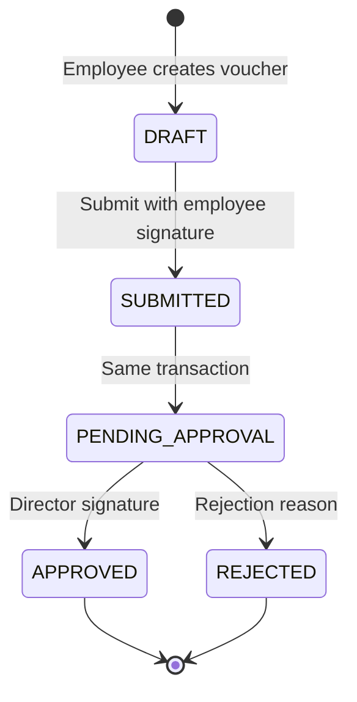
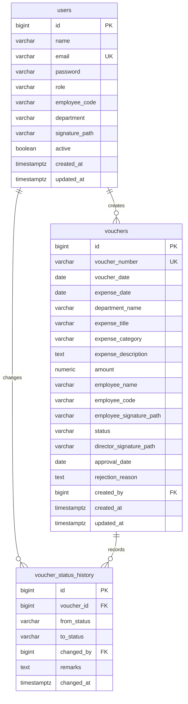

# ExpenseFlow — Expense Voucher Management System

ExpenseFlow digitizes ABC Company's expense voucher process. Employees create and track their own vouchers, the Director approves or rejects them, and the Accounts team reviews the organization-wide register for reimbursement. Access is enforced on the API and in the React application.

## Features by role

### Employee
- Sign in and maintain a profile signature.
- Create a voucher as a draft, edit it, or delete it while it is still a draft.
- Attach a signature (upload or reuse the saved profile signature) and submit it for approval.
- See only vouchers they created, including the full detail page, status timeline, and the Director's rejection reason.

### Director
- See every voucher, with search, filters, and sorting.
- Review the pending queue.
- Approve a pending voucher with a signature, or reject it with a mandatory reason.
- Employee-entered voucher details are not editable.

### Accounts
- See every voucher across the company, with the same search, filter, and sort tools.
- Open a read-only voucher that shows both signatures and the approval status.
- Print the voucher (print stylesheet) or download a PDF.

Accounts cannot create, edit, delete, approve, or reject vouchers. Employees cannot see other employees' vouchers. Only the Director can approve or reject, and only while a voucher is pending approval.

## Tech stack

| Layer | Choices |
| --- | --- |
| Backend | Java 17, Spring Boot 3.4, Spring Web, Spring Security + JWT, Spring Data JPA, Bean Validation, Lombok, Flyway, springdoc-openapi |
| Database | PostgreSQL |
| Frontend | React 18, Vite, React Router 6, Axios, React Hook Form, Zod, Tailwind CSS, Recharts, lucide-react, react-hot-toast |
| Files | Signature images stored under `uploads/signatures` and served by an authenticated endpoint |

## Prerequisites

- JDK 17
- Maven 3.9+
- Node.js 18+ and npm
- PostgreSQL 14+ (this project was developed against PostgreSQL 17)

## Setup

### 1. Create the database

```sql
CREATE DATABASE expense_voucher;
```

With `psql`:

```bash
psql -U postgres -c "CREATE DATABASE expense_voucher;"
```

Docker is optional:

```bash
docker compose up -d
```

The compose file creates `expense_voucher` with user `postgres` and password `postgres`.

### 2. Backend environment

```bash
cd backend
copy .env.example .env
```

`application.yml` already defaults to the values in `.env.example`. Override them in the shell when your database password differs:

```powershell
$env:DB_PASSWORD = "your-postgres-password"
mvn spring-boot:run
```

Flyway applies `V1__schema.sql` and `V2__seed.sql` on startup. Swagger UI is at [http://localhost:8081/swagger-ui.html](http://localhost:8081/swagger-ui.html).

### 3. Frontend

```bash
cd frontend
copy .env.example .env
npm install
npm run dev
```

Open [http://localhost:5173](http://localhost:5173).

### Tests

```bash
cd backend
mvn test
```

`VoucherServiceTest` covers the workflow rules. `VoucherControllerSecurityTest` checks that anonymous users are rejected and that the Accounts and Director roles cannot call employee-only endpoints.

## Environment variables

### Backend (`backend/.env.example`)

| Variable | Purpose | Default |
| --- | --- | --- |
| `DB_URL` | JDBC URL | `jdbc:postgresql://localhost:5432/expense_voucher` |
| `DB_USER` | Database user | `postgres` |
| `DB_PASSWORD` | Database password | `postgres` |
| `JWT_SECRET` | HMAC secret, at least 32 bytes | dev placeholder in `application.yml` |
| `JWT_EXPIRATION_MS` | Access token lifetime | `86400000` (24 hours) |
| `UPLOAD_DIR` | Signature storage root | `uploads` |
| `MAX_FILE_SIZE_BYTES` | Signature size limit | `2097152` (2 MB) |
| `APP_TIMEZONE` | Business clock for "today" and future-date checks | `Asia/Kolkata` |
| `CORS_ORIGINS` | Allowed browser origins | `http://localhost:5173,http://127.0.0.1:5173` |
| `SERVER_PORT` | API port | `8081` |

### Frontend (`frontend/.env.example`)

| Variable | Purpose | Default |
| --- | --- | --- |
| `VITE_API_BASE_URL` | Backend API base | `http://localhost:8081/api` |

Replace `JWT_SECRET` before any shared deployment. The checked-in default is for local development only.

If the API fails with `password authentication failed for user "postgres"`, the PostgreSQL service on port 5432 is using a different password. Set `DB_PASSWORD` (and `DB_USER` if needed) to the real account before `mvn spring-boot:run`. Docker Compose in this repo uses `postgres` / `postgres` on port 5432.

## Demo credentials

Every demo account uses the password `Password@123`.

| Role | Name | Email | Employee ID | Department |
| --- | --- | --- | --- | --- |
| Director | Priya Sharma | director@abc.com | — | Administration |
| Accounts | Rahul Mehta | accounts@abc.com | — | Finance |
| Employee | Ananya Iyer | ananya.iyer@abc.com | EMP-1001 | Engineering |
| Employee | Karan Patel | karan.patel@abc.com | EMP-1002 | Sales |
| Employee | Meera Nair | meera.nair@abc.com | EMP-1003 | Marketing |

The seed migration also loads 25 vouchers across draft, pending approval, approved, and rejected states, with status history for the submitted step. Sample signature images are copied into the upload directory on startup.

## Workflow



On submit, the service writes both `DRAFT -> SUBMITTED` and `SUBMITTED -> PENDING_APPROVAL` in one transaction, so the timeline shows the submitted step even though the current status becomes Pending Approval. Invalid transitions return HTTP 409. Approved and rejected vouchers are terminal.

## Database schema



`users.created_by` is not a column. `vouchers.created_by` references `users.id`. History rows reference both the voucher and the user who made the change. Deleting a draft cascades to its history rows.

Voucher numbers come from the PostgreSQL sequence `voucher_number_seq` and are formatted as `EV-{year}-{000000}`. The unique constraint on `voucher_number` is the second guard. Indexes cover `voucher_number` (unique), `status`, `created_by`, `expense_date`, `department_name`, and `expense_category`.

Check constraints keep `amount > 0`, restrict status and category values, require a rejection reason of at least 10 characters when status is `REJECTED`, require a director signature when status is `APPROVED`, and require an employee signature once a voucher leaves `DRAFT`.

`employee_code` on a voucher is the optional employee ID, snapshotted from the user when the draft is saved. Amounts use `NUMERIC(12,2)` and `BigDecimal`.

Departments: Engineering, Finance, HR, Sales, Marketing, Operations, IT Support, Legal, Administration.

Categories: Travel, Food & Meals, Accommodation, Office Supplies, Software & Subscriptions, Client Entertainment, Fuel & Transport, Training, Communication, Miscellaneous.

## API

Successful JSON responses use:

```json
{ "success": true, "message": "OK", "data": {}, "meta": { "page": 0, "size": 10, "totalElements": 25, "totalPages": 3 } }
```

`meta` is present on paginated lists. Errors use:

```json
{
  "timestamp": "2026-10-10T16:00:00Z",
  "status": 400,
  "error": "Bad Request",
  "message": "Amount must be greater than 0",
  "path": "/api/vouchers",
  "fieldErrors": { "amount": "Amount must be greater than 0" }
}
```

List filters (all optional): `voucherNumber`, `employeeName`, `department`, `category`, `status`, `fromDate`, `toDate`, `minAmount`, `maxAmount`, `search`, `sortBy`, `sortDir`, `page`, `size`. `GET /api/vouchers/my` always adds the signed-in employee as the owner on the server.

| Method | Path | Roles | Request | Response |
| --- | --- | --- | --- | --- |
| POST | `/api/auth/register` | Public | Register JSON below | `201` user profile, no password and no token |
| POST | `/api/auth/login` | Public | `{ "email", "password" }` | `{ accessToken, tokenType, expiresIn, user }` |
| GET | `/api/auth/me` | Any authenticated | — | User profile |
| POST | `/api/auth/logout` | Any authenticated | — | Acknowledgement; the client drops the JWT |
| GET | `/api/users/me` | Any authenticated | — | User profile |
| POST | `/api/users/me/signature` | Any authenticated | multipart `file` | Updated user |
| POST | `/api/vouchers` | Employee | Voucher JSON | `201` draft voucher |
| PUT | `/api/vouchers/{id}` | Employee, own draft | Voucher JSON | Updated draft |
| DELETE | `/api/vouchers/{id}` | Employee, own draft | — | Deletion message |
| POST | `/api/vouchers/{id}/submit` | Employee, own draft with signature | — | Pending voucher |
| GET | `/api/vouchers/my` | Employee | Filters | Page of own vouchers |
| GET | `/api/vouchers/pending` | Director | Filters | Pending page |
| GET | `/api/vouchers` | Director, Accounts | Filters | All vouchers |
| GET | `/api/vouchers/{id}` | Owner, Director, Accounts | — | Voucher plus history |
| POST | `/api/vouchers/{id}/signature` | Employee, own draft | multipart `file` | Voucher |
| POST | `/api/vouchers/{id}/signature/use-profile` | Employee, own draft | — | Voucher with copied signature |
| POST | `/api/vouchers/{id}/approve` | Director | multipart `signature`, optional `useSaved` | Approved voucher |
| POST | `/api/vouchers/{id}/reject` | Director | `{ "reason" }` min 10 chars | Rejected voucher |
| GET | `/api/vouchers/{id}/pdf` | Anyone who can view the voucher | — | `application/pdf` |
| GET | `/api/files/signatures/{fileName}` | Authenticated, if the file is theirs or on a voucher they can view | — | Image |
| GET | `/api/dashboard/employee` | Employee | — | Own metrics, charts, recent vouchers |
| GET | `/api/dashboard/director` | Director | — | Queue, today counts, activity, charts |
| GET | `/api/dashboard/accounts` | Accounts | — | Organization totals and reimbursement charts |

### Register

`POST /api/auth/register` is public. The server always stores role `EMPLOYEE` and ignores any `role` field in the body. The response is `201` and does not include a password or a token. The client returns the person to Sign in.

```json
{
  "name": "Neha Sharma",
  "email": "neha.sharma@abc.com",
  "password": "Password@123",
  "confirmPassword": "Password@123",
  "employeeId": "EMP-2001",
  "department": "Engineering"
}
```

`employeeId` is optional. `department` must be one of the voucher departments. Password must be at least 8 characters and include an uppercase letter, a lowercase letter, and a number. `confirmPassword` must match.

Success:

```json
{
  "success": true,
  "message": "Account created successfully",
  "data": {
    "id": 6,
    "name": "Neha Sharma",
    "email": "neha.sharma@abc.com",
    "role": "EMPLOYEE",
    "employeeCode": "EMP-2001",
    "department": "Engineering",
    "signatureFileName": null,
    "active": true
  }
}
```

Errors use the shared error body. Validation failures are `400` with `fieldErrors` (for example `password` or `confirmPassword`). A duplicate email, compared without case, is `409` with message `An account with this email already exists`.

### Sample login

```http
POST /api/auth/login
Content-Type: application/json

{ "email": "director@abc.com", "password": "Password@123" }
```

```json
{
  "success": true,
  "message": "Login successful",
  "data": {
    "accessToken": "<jwt>",
    "tokenType": "Bearer",
    "expiresIn": 86400,
    "user": {
      "id": 1,
      "name": "Priya Sharma",
      "email": "director@abc.com",
      "role": "DIRECTOR",
      "employeeCode": null,
      "department": "Administration",
      "signatureFileName": "seed-director.png",
      "active": true
    }
  }
}
```

### Sample draft

```json
{
  "voucherDate": "2026-10-10",
  "expenseDate": "2026-10-09",
  "departmentName": "Engineering",
  "expenseTitle": "Pune client visit",
  "expenseCategory": "TRAVEL",
  "expenseDescription": "Cab and train fare",
  "amount": 2450.50
}
```

Send `Authorization: Bearer <token>` on every other endpoint. A missing or expired token returns 401. A role that is signed in but not allowed returns 403. An employee asking for someone else's voucher receives 404.

## Business rules

1. Every voucher has a unique voucher number.
2. Numbers are generated from a database sequence.
3. A new voucher starts as `DRAFT`.
4. Employees can edit or delete only their own drafts.
5. Submitted vouchers are read-only for employees.
6. Only the Director can approve or reject, and only from `PENDING_APPROVAL`.
7. Approved vouchers are terminal and read-only.
8. Rejection requires a reason of at least 10 characters.
9. Employees can view only their own vouchers.
10. The Director can view every voucher.
11. Accounts can view every voucher.
12. Submission requires the employee signature.
13. Approval requires the Director signature.

Validation also requires department, title, a non-future expense date, and an amount strictly greater than 0 with at most two decimal places. Signature uploads must be PNG or JPG and at most 2 MB.

## Assumptions

- Currency is Indian Rupees. Amounts in words use the lakh/crore scale. The PDF labels the amount as INR.
- "Today" and the future-date rule use `Asia/Kolkata` unless `APP_TIMEZONE` is changed.
- Total amount claimed on the employee dashboard is the sum of that employee's non-draft vouchers. Approved spend charts use approved vouchers only.
- Pending approval counts include a `SUBMITTED` row if one exists. The normal submit path does not leave a voucher in `SUBMITTED`.
- Employee name and employee ID are snapshotted from the signed-in user. The form does not let someone file a voucher as a different employee.
- Voucher date can be edited on a draft. Only the expense date is blocked from being in the future.
- Logout is stateless: the API acknowledges it and the browser deletes the token.
- Profile signature files are copied onto a voucher so a later profile change does not rewrite an already attached signature.
- Seed voucher numbers use the calendar year of the day the migration runs, matching the generator.
- Self-registration creates Employee accounts only; Director and Accounts accounts are provisioned by seed data.

## Project layout

```
backend/          Spring Boot API, Flyway migrations, tests
frontend/         React application
docs/screenshots/ Placeholder for UI captures
docker-compose.yml
README.md
```

Backend packages under `com.abc.expensevoucher`: `config`, `controller`, `service`, `repository`, `entity`, `dto`, `mapper`, `security`, `exception`, `util`, `specification`, `validation`.

Frontend `src`: `api`, `components`, `layouts`, `pages` (`auth`, `employee`, `director`, `accounts`, `common`), `routes`, `context`, `hooks`, `utils`, `validations`.

## Screenshots

Add captures to `docs/screenshots/` after the first run:

- `login.png` — split login with demo account buttons
- `employee-dashboard.png` — stat cards and charts
- `director-queue.png` — pending approvals
- `accounts-voucher.png` — printable voucher with signatures
- `dark-mode.png` — any authenticated page in dark mode

The login screen includes one-click demo fills for Director, Accounts, and Employee.
